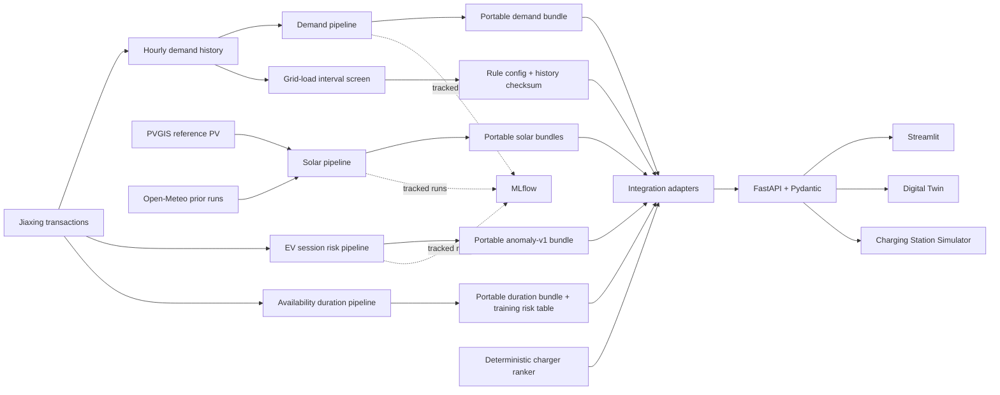

# Running architecture

Editable Mermaid source: `docs/architecture.mmd`. Demand, 24h/48h solar, EV session risk and availability use portable bundles. Grid-load anomaly uses a checksum-checked rule configuration and the committed historical demand proxy. The ranker uses caller-supplied historical charger state and a training-period abnormal-end rate; missing demand/solar terms are disclosed neutral constants. All components use FastAPI/Streamlit historical contracts. Digital Twin and Charging Station Simulator are deterministic simulation tools, not live grid controls. MLflow records training experiments, while runtime serving has no MLflow dependency.
