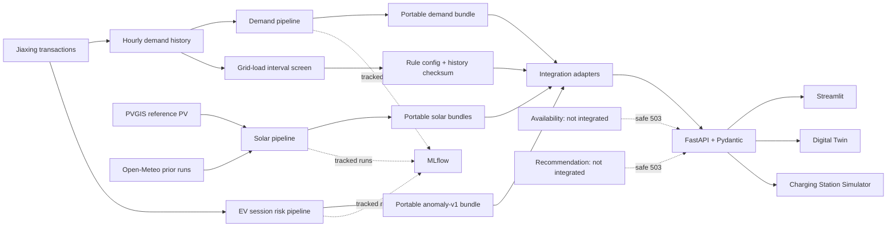

# Running architecture

Editable Mermaid source: `docs/architecture.mmd`. Demand, 24h/48h solar, and EV session risk use portable bundles. Grid-load anomaly uses a checksum-checked rule configuration and the committed historical demand proxy. All four are integrated with FastAPI/Streamlit; the Grid-load endpoint does not alter the session-risk endpoint. Digital Twin and Charging Station Simulator are deterministic simulation tools, not live grid controls. MLflow records training experiments, while runtime serving has no MLflow dependency. Availability and recommendation adapters safely return 503 until model handoff.
